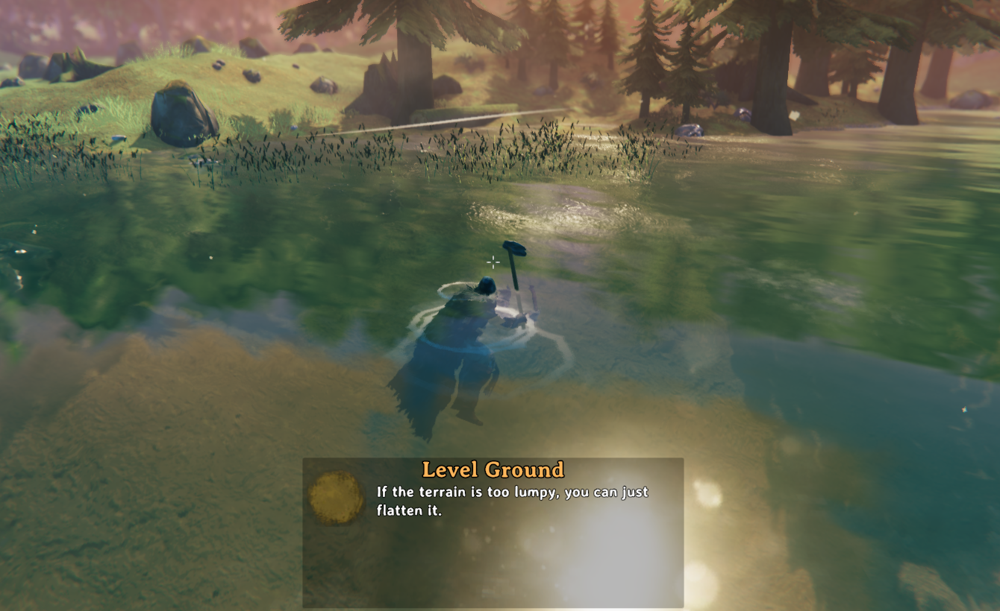

# EquipmentInWater

Use your equipment while in the water.

While swimming you can equip weapons, tools and shields, keep them in your hands, and take them back out with the hide/show weapons key.
Using them still costs stamina as usual, and stamina doesn't regenerate while swimming, so keep an eye on it in deep water.

## Configuration

This mod has no settings.

## Compatibility

- Other mods that change swimming, or what the player can do in water, may conflict with this mod.
- This mod has not been tested with a gamepad, only with keyboard and mouse.

## Uninstalling

Nothing is saved to your world or character, so the mod can be removed at any time.

## License

This project is licensed under the MIT License - see the [LICENSE](https://github.com/javidahmed64592/Valheim-EquipmentInWater/blob/main/LICENSE) file for details.
